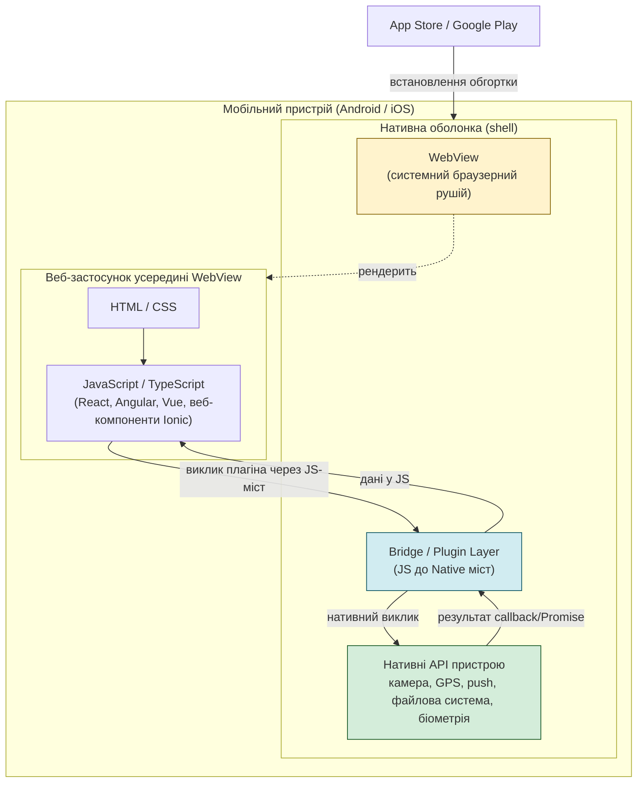

# Практична робота 1. Загальний огляд мобільних платформ

---

## 1. Мета

Розібрати принцип роботи гібридного мобільного застосунку, визначити межі застосовності підходу та порівняти його з Flutter за продуктивністю, доступом до API й вартістю підтримки, щоб сформувати обґрунтований критерій вибору технології.

---

## 2. Принцип роботи гібридного застосунку

Гібридний застосунок - це веб-застосунок (HTML/CSS/JavaScript), запакований у нативний контейнер (WebView), який отримує доступ до апаратних можливостей пристрою через прошарок плагінів-мостів (bridge). Сучасні реалізації - **Capacitor** (розвиток Ionic) та **Apache Cordova** (класична, дедалі менш актуальна реалізація); поверх контейнера часто працює UI-фреймворк на кшталт **Ionic Framework** з веб-компонентами.

Ключова відмінність від Flutter/React Native: UI не рендериться нативними або власними графічними примітивами, а показується всередині вбудованого браузерного рушія (WebView), невидимого для користувача.

### 2.1 Архітектура

**Як це працює покроково:**
1. Застосунок запускається як нативний apk/ipa-контейнер, усередині якого одразу відкривається WebView з локально упакованими HTML/CSS/JS-файлами (не з інтернету).
2. Уся бізнес-логіка й UI виконуються звичайним JavaScript-кодом, як на сайті.
3. Коли потрібен доступ до апаратної функції (камера, GPS, push-сповіщення), JS-код викликає функцію плагіна; виклик серіалізується і передається через міст (bridge) у нативний код (Java/Kotlin або Objective-C/Swift).
4. Нативний код виконує реальну операцію (наприклад, відкриває камеру), а результат повертається назад у JS через callback або Promise.
5. Кожен новий тип апаратного доступу потребує окремого плагіна — якщо готового плагіна немає, його доведеться писати нативно самостійно.

---

## 3. Класи задач: де гібридний підхід виправданий, а де провальний

### 3.1 Виправданий гібридний підхід

| № | Клас задач | Пояснення причини |
|---|---|---|
| 1 | **Обгортка наявного веб-застосунку / внутрішнього корпоративного порталу** | Якщо продукт уже існує як SPA (React/Angular/Vue), Capacitor дозволяє випустити мобільну версію майже без переписування коду — витрати мінімальні, а вимоги до продуктивності UI невисокі (форми, таблиці, списки). |
| 2 | **MVP/прототип з дуже обмеженим бюджетом і командою суто веб-розробників** | Команда без досвіду мобільної розробки може почати виробництво негайно, використовуючи знайомий стек; швидкість виходу важливіша за якість анімацій чи fps. |
| 3 | **Застосунки з переважно статичним/інформаційним контентом** (каталоги, довідники, форми звітності, внутрішні CRM-клієнти, B2B-інструменти для обмеженої аудиторії) | Такі застосунки не потребують складних жестів, 60 fps анімацій чи інтенсивної роботи з графікою — обмеження WebView в цьому сценарії практично непомітні для користувача. |

### 3.2 Провальні сценарії

| № | Клас задач | Пояснення причини |
|---|---|---|
| 1 | **Застосунки з інтенсивною графікою / анімацією / іграми** (списки, що швидко скролляться з тисячами елементів, кастомні жести, ігрові механіки) | WebView-рендеринг програє нативному чи Flutter-рендерингу за fps на слабких і навіть середніх Android-пристроях; тюнінг продуктивності доводиться повторювати після кожного оновлення ОС, оскільки він "не переживає" оновлення WebView-рушія.[^1] |
| 2 | **Продукти, що критично залежать від найновіших платформних API** (наприклад, свіжі можливості ARKit/ARCore, нові сенсори, Live Activities на iOS) | Доступ до нового API з'являється лише тоді, коли хтось напише або оновить відповідний плагін-міст; на практиці плагіни ламаються після кожного великого оновлення iOS, і команда залежить від сторонніх мейнтейнерів-волонтерів, чий супровід не можна гарантувати.[^1] |
| 3 | **Fintech/платіжні застосунки з жорсткими вимогами до безпеки та відповідності стандартам (PCI DSS), біометричної автентифікації, offline-режиму з локальним шифруванням** | Чутливі операції (зберігання ключів, Secure Enclave, надійна ізоляція пам'яті) складно гарантувати через прошарок WebView + JS-міст; для аудиту безпеки нативна або Flutter-реалізація з прямим доступом до платформних криптографічних API є значно прозорішою і передбачуванішою. |

---

## 4. Порівняння: гібридний підхід vs Flutter

| Критерій | Гібридний підхід (Capacitor/Ionic) | Flutter |
|---|---|---|
| **Продуктивність рендерингу** | Рендеринг через WebView; на списку з великою кількістю елементів (~1000) реальні виміри дають близько 60 fps на iOS і 50 fps на середньому Android — "близько до нативного, але не ідентично"[^1] | Власний рушій рендерингу (Impeller, з 2024–2025 замінив Skia як бекенд за замовчуванням), стабільні 60 fps і вище практично на всіх сучасних пристроях[^2] |
| **Доступ до нативних API** | Через плагіни-мости; якщо готового плагіна немає — потрібно писати нативний код (Kotlin/Swift) самостійно; плагіни періодично ламаються при оновленнях ОС | Прямий доступ через власні binding-и та платформні канали (platform channels); екосистема плагінів менша за нативну, але стабільніша за Cordova/Capacitor завдяки єдиному вендору (Google) та строгішій типізації |
| **"Нативність" відчуттів (UX)** | UI — це, по суті, веб-сторінка; навіть із веб-компонентами Ionic анімації, тіні, haptics відчутно відрізняються від нативних для досвідченого користувача | Власний UI-рушій дає однаковий, керований, але не завжди "платформово ідентичний" вигляд; для iOS-стилю потрібні Cupertino-віджети |
| **Вартість розробки MVP (обгортка наявного веб-застосунку)** | Найнижча: орієнтовно $40 000–$80 000 для обгортки наявного вебзастосунку з базовими нативними фічами[^3] | Вища для аналогічного функціоналу "з нуля": орієнтовно $90 000–$170 000, оскільки немає готового веб-коду для перевикористання і потрібне вивчення Dart[^3] |
| **Вартість довгострокової підтримки** | Може зростати непропорційно: build time довший (приклад — "чистий" Capacitor-білд займав ≈5 хв і накопичувався в CI), а плагіни потребують ручного відстеження сумісності з кожним релізом iOS/Android[^1] | Передбачуваніша підтримка: оновлення SDK відбуваються за єдиним циклом Google, менше "плаваючих" сторонніх залежностей у критичному шляху рендерингу |
| **Придатність для існуючого веб-продукту** | Найкращий сценарій use case — перевикористання наявного коду фронтенду майже без змін | Не застосовно — потрібна розробка з нуля на Dart, перевикористати веб-код неможливо |

**Підсумок порівняння:** гібридний підхід виграє там, де вже існує веб-кодова база і продуктивність некритична; Flutter виграє там, де потрібні передбачувана продуктивність, стабільний доступ до нативних API та довгостроково дешевша підтримка "з нуля".

---

## 5. Чек-лист: коли обирати гібридний підхід

Якщо на **всі п'ять** питань відповідь "так" — гібридний підхід (Capacitor/Ionic) є обґрунтованим вибором:

1. **Чи вже існує робочий веб-застосунок (SPA) на React/Angular/Vue/vanilla JS, який можна перевикористати як основу?**
2. **Чи є вимоги до продуктивності UI помірними** (списки, форми, каталоги — без інтенсивної анімації, ігрової механіки чи AR)?
3. **Чи команда складається переважно з веб-розробників без досвіду Kotlin/Swift/Dart, а термін проєкту не дозволяє їх найняти чи навчити?**
4. **Чи набір потрібних нативних можливостей (камера, GPS, push, біометрія базового рівня) повністю покривається готовими, активно підтримуваними Capacitor-плагінами** — без потреби у свіжих чи вузькоспеціалізованих платформних API?
5. **Чи продукт не обробляє надчутливі дані, що підпадають під жорсткі вимоги безпеки/комплаєнсу** (платіжні дані рівня PCI DSS, медичні дані, криптографічні ключі), для яких потрібна нативна ізоляція?

Якщо хоча б на одне питання відповідь "ні" — варто розглянути Flutter або нативну розробку замість гібридного підходу.

---

## 6. Висновок

**Рішення:** для проєкту, що є мобільною обгорткою вже наявного веб-застосунку (внутрішній корпоративний інструмент, B2B-портал чи інформаційний сервіс) із командою веб-розробників і обмеженим бюджетом, обґрунтованим вибором є **гібридний підхід на основі Capacitor**, а не Flutter.

**Три аргументи на користь рішення:**
1. **Перевикористання коду.** Наявна веб-кодова база переноситься в мобільний застосунок майже без змін, тоді як Flutter вимагав би розробки UI та логіки з нуля на Dart.
2. **Нижчий поріг входу та вартість MVP.** Команда веб-розробників не потребує перекваліфікації; за оцінками ринку, обгортка наявного застосунку через Capacitor коштує суттєво менше, ніж повноцінна Flutter-розробка "з нуля" ($40–80 тис. проти $90–170 тис.)[^3].
3. **Достатність можливостей для некритичного UI.** Для форм, списків та інформаційного контенту різниця у fps між WebView і нативним рендерингом непомітна для типового користувача, тому платити за продуктивність Flutter немає економічного сенсу.

**Визнаний ризик:** довгострокова вартість підтримки може виявитися прихованою — плагіни-мости історично ламаються після великих оновлень iOS/Android і залежать від активності сторонніх мейнтейнерів, тому проєкт потребує явного бюджету на регулярний моніторинг сумісності плагінів, а не лише на початкову розробку.

---

## 7. Джерела

[^1]: Emadideen Ghannam. *Flutter, Ionic, or Cordova: a 14-year mobile cross-platform retrospective.* Особистий досвід продуктивності WebView (60 fps на iOS / 50 fps на Android для списку з 1000 елементів), нестабільність плагінів після оновлень ОС, час білду Capacitor. URL: https://emadideen.com/posts/flutter-vs-ionic-vs-cordova/ (дата звернення: 10.09.2026).
[^2]: AgileSoft Labs. *Flutter vs React Native 2026: Performance Cost DX.* Дані про перехід Flutter на рушій Impeller та приріст швидкості растеризації кадрів. URL: https://www.agilesoftlabs.com/blog/2026/02/flutter-vs-react-native-2026-cost-dx_17 (дата звернення: 10.09.2026).
[^3]: Kanopy Labs. *Capacitor vs React Native vs Flutter: Hybrid Apps in 2026.* Орієнтовна вартість розробки: Capacitor $40K–$80K (обгортка наявного вебзастосунку), Flutter $90K–$170K (розробка з нуля). URL: https://kanopylabs.com/blog/capacitor-vs-react-native-vs-flutter (дата звернення: 10.09.2026).

> **Примітка щодо методології:** наведені суми вартості розробки — орієнтовні ринкові оцінки консалтингових блогів, а не результати контрольованого дослідження; вони використані лише для ілюстрації порядку різниці у вартості (у рази), а не як точні кошториси.
